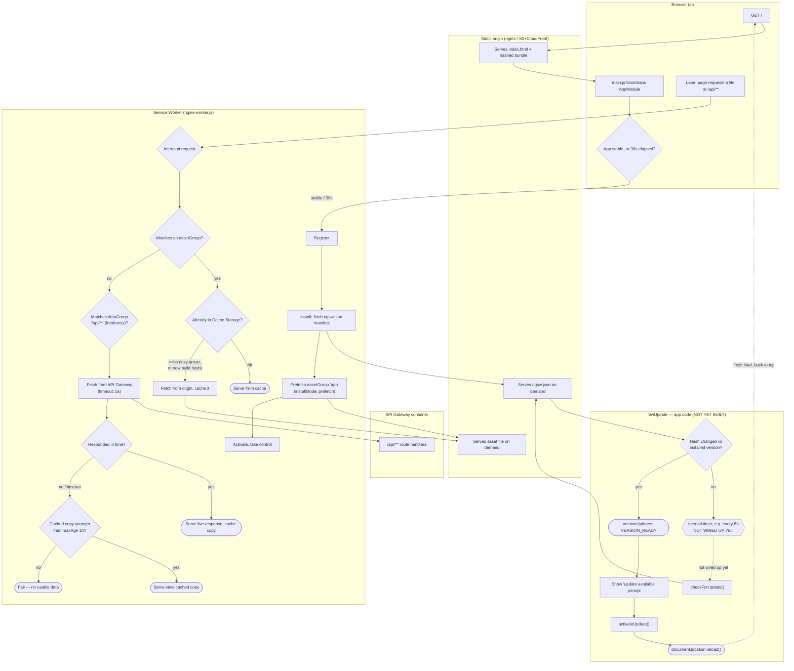

# T062 — Angular PWA: Service Worker Install & Request Routing

Quick-glance boxes-and-arrows reference for how a request actually flows through the
service worker. No prose — if you need the "why," see `.claude/tickets/T062.md`.
Generated/updated via `/diagram-task`.

Asset invalidation is hash-based (a new build changes the file's hash — no TTL involved);
data invalidation is purely time-based (`maxAge`) — the two groups never share an
invalidation mechanism. The `UPDATE` subgraph is the only path that re-checks `ngsw.json`
without a reload — see `.claude/notes/follow-ups.md`'s "From T062" entry #4; nothing in it
is implemented yet, so a currently-open tab never takes this path on its own.
