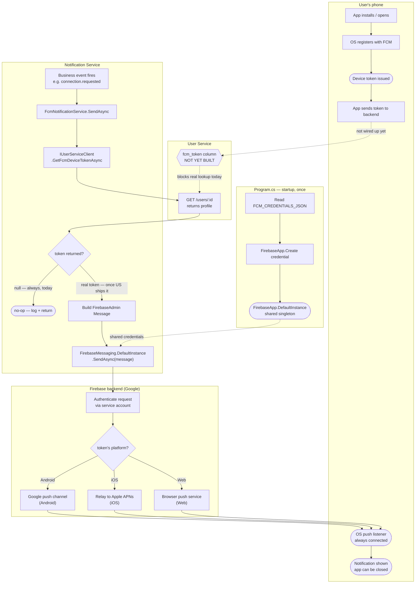

# FCM Push Notification — End-to-End Delivery Flow

Quick-glance boxes-and-arrows reference for how a push notification actually travels from
our server to a phone. No prose — if you need the "why," see T047's ticket/review or
`.claude/notes/follow-ups.md`'s "From T047" entries.

The server never holds a direct connection to the phone — it only ever talks to Firebase's
backend over plain HTTPS; the always-open connection is between the device's OS and its
platform's push service, maintained independently of whether our app is running.
